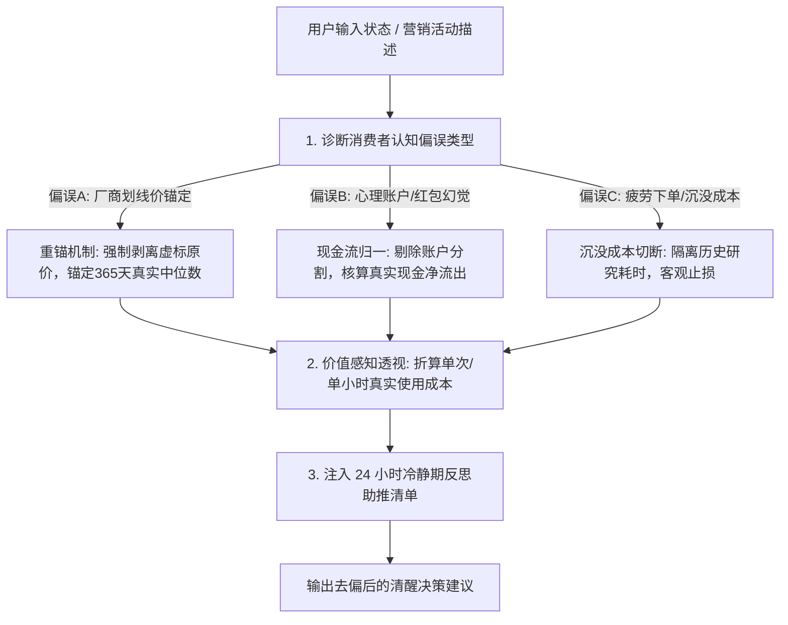

# 行为经济学消费偏误反制与助推技能规范 (Behavioral Debiasing Nudges)

传统经济学假定消费者是完全理性的效用最大化机器，但行为经济学（Kahneman, Tversky, Thaler）的大量实证表明：
**现代电商平台的促销机制是高度精密利用人类认知偏误的“心理学装置”**。
消费者在做耐用品决策时，常被**虚标划线价锚定**、**心理账户分割**与**沉没时间成本**深深操纵，做出买后迅速后悔的非理性决策。

本技能通过**行为偏误反制（Debiasing）**与**积极选择架构助推（Nudge）**，担任用户的理性“认知外骨骼”。

---

## 核心执行流程

---

## 第一部分：三大致命消费认知偏误的反制机制 (Debiasing Engine)

### 1. 虚标参考价与划线价去锚定 (Anchor Neutralization)
- **商家套路**：商品页面标出 *“原价 ¥9,999，直降 ¥2,300，现仅需 ¥7,699”*，诱导用户将 9,999 当作心理价值参考点，产生“狂赚 2300”的错觉。
- **反制准则**：
  - **强制剥离划线价**：Agent 严禁引用商家自称的“原价”；
  - **真实重锚**：强制重锚为**近 1 年该商品历史实际成交价的中位数** $\text{Median}_{365}$；
  - *系统提示*：“该商品近 365 天实际成交中位数仅为 7,800 元，当前 7,699 元仅为正常常态价格，实际让利仅约 1.3%，而非页面宣称的狂省 23%。”

### 2. 心理账户分割幻觉破除 (Mental Accounting De-biasing)
- **商家套路**：利用以旧换新补贴、电商礼品卡、京豆、红包抵扣，让消费者觉得“用的是送的钱，等于免费或没花多少”。
- **反制准则**：
  - **真实现金流归一化（Net Cashflow Normalization）**：将补贴、旧机折价、礼品卡全部视作无差别的法定货币现金；
  - *系统提示*：“旧机在二手平台可卖 2,000 元现金，您在以旧换新中抵扣 2,000 元，本质上依然是您实实在在支出了 2,000 元真实资产，切勿产生‘没花钱’的心理账户幻觉。”

### 3. 沉没时间成本疲劳止损 (Sunk Time Cost Shield)
- **消费者偏误**：*“我已经在各个论坛看了 3 天评测、比价了 5 个平台，再不买我这几天就白折腾了。”*
- **反制准则**：
  - 严厉提醒：**过去的调研时间已经是沉没成本，买入错误的产品不仅找不回时间，还会进一步浪费金钱。** 及时观望才是最大化总效用的最优解。

---

## 第二部分：积极助推机制 (Choice Architecture Nudges)

为帮助用户直观感受真实开销，系统引入两项实用的助推工具：

### 1. 单次/单小时真实使用成本透视 (Cost-Per-Use Metric)
用户对一次性支付 8,000 元往往感知迟钝，Agent 将耐用品价格拆解为高感知的**“单次使用成本”**：

$$\text{CPU} = \frac{\text{入手总价} - \text{预期2年后残值}}{\text{预期持有天数} \times \text{日均使用频次}}$$

- *案例*：买一张 8,000 元游戏显卡，若用户预期 2 年后残值 3,500 元，实际折旧 4,500 元。
  - 若用户是**重度玩家**（每天玩 2 小时，共 1460 小时）：折合 **¥3.08 元/小时**（极高性价比，生产力/精神愉悦充沛）；
  - 若用户是**三分钟热度轻度玩家**（平均每周玩 1 次，共 100 次）：折合 **¥45.0 元/次**；
  - *助推提示*：“每次开机打游戏相当于门票支出 45 元，请评估您实际会开机多少次，避免贵重设备吃灰。”

### 2. 24 小时冷静期反思助推清单 (24-Hour Cooling Checklist)
当检测到用户处于冲动消费或深夜下单时，Agent 自动附带四问自检助推：
1. **必要性检查**：如果明天这个价格涨回 200 元，您是否依然觉得非买不可？
2. **替代品检查**：您手头现有的设备是否真的已经彻底无法满足当前工作/游戏？
3. **空间与时间检查**：未来两周内，您真的有充裕的闲暇时间使用它吗？
4. **睡眠测试**：将商品加入购物车，关闭应用睡一觉，明天上午 10 点如果依然心动再做决定。

---

## 验证与自检工具

- 运行脚本：`python .agents/skills/behavioral-debiasing-nudges/scripts/nudge_bias_evaluator.py --price 7699 --claimed_anchor 9499 --residual 3500 --weekly_hours 4`
- 输出结果：自动计算划线价虚标率、真实中枢偏差、单小时使用成本，并生成助推提醒。
