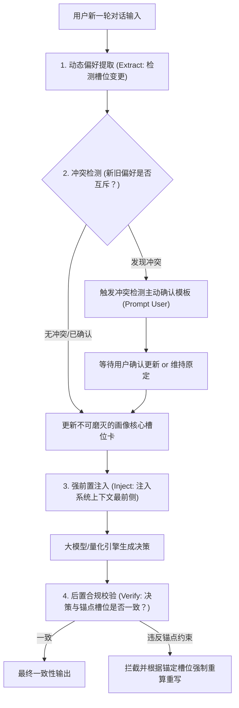

# 上下文偏好锚定与跨会话重建技能规范 (Context Anchoring Protocol)

在复杂的消费与量化咨询多轮对话中，大语言模型极易出现**“上下文记忆衰减与偏好漂移”（Preference Drift）**：
例如用户在前两轮明确表明“预算仅限 5000 元、可等待 3 个月”，但在第 5 轮讨论其他配件后，模型在推荐核心产品时遗忘了预算和期限约束，给出了互相矛盾甚至推荐超预算旗舰的错误回答。

本技能通过**上下文锚定（Context Anchoring）**、**提取-注入-校验（Extract-Inject-Verify Pipeline）**、**冲突检测模板（Conflict Detection Templates）**与**跨对话重建协议（Cross-Session Reconstruction Protocol）**，确保用户偏好全生命周期一致性。

---

## 核心执行流程



---

## 第一部分：上下文锚定机制 (Context Anchoring Frame)

系统定义 8 个**“不可磨灭的画像核心槽位”（Core Profile Slots）**。
无论对话进行到第几轮，这些槽位必须保持显式锁定，并在系统 Prompt 或推理链中置顶呈现为【锚定画像状态卡】：

```json
{
  "_anchor_state": {
    "category": "显卡",                 // 品类归属（决定必需闸门 vs 时机模型）
    "purpose": "AI / 跑模型",           // 核心用途（决定满足度底线与性能折算比）
    "deadline": "within_30",            // 最晚期限（决定最大可等待天数封顶）
    "usage_intensity": "high",          // 使用强度（决定月度效用损失率 U）
    "budget_tier": "mid",               // 预算档位（决定价格上限与平替接受度）
    "alt_acceptable": "no",             // 替代品接受度（yes/no，决定是否推平替）
    "hedonic": "utilitarian",           // 属性（utilitarian 生产力工具 vs hedonic 纯享乐）
    "wait_tier": "low",                 // 等待折扣意愿（low/mid/high 贴现系数）
    "last_updated_turn": 3,             // 最近更新轮次
    "status": "LOCKED"                  // 状态：LOCKED（锁定）/ OVERRIDDEN（已重算覆盖）
  }
}
```

---

## 第二部分：提取-注入-校验流水线 (Extract-Inject-Verify Pipeline)

每轮对话必须严格执行三步流水线：

### 1. 提取 (Extract)
- 实时语义解析用户最新输入，识别是否存在对 8 大槽位的新增、撤销或修改信号。
- *示例*：用户输入 *“下周老板就要检查进度了，急用”* → 提取出 `deadline = "now"` / `usage_intensity = "high"`。

### 2. 注入 (Inject)
- 在将用户输入提交给推理层前，强制在上下文最前侧注入【当前生效锚点约束】：
  > `[SYSTEM ENFORCED ANCHOR]: 当前用户已锁定画像：用途=AI实验，预算=中等，不可接受跨品平替，最晚期限=30天。生成的任何决策卡与自然语言建议严禁突破上述约束。`

### 3. 校验 (Verify)
- 模型生成候选回复后，后置自动化检查器（Guardrail）比对生成内容与锚定槽位：
  - *反例拦截*：若锚定 `budget_tier = "low"`，而候选回复推荐了售价 9,499 元的顶级非公版显卡 → **立刻拦截并打回重算**。

---

## 第三部分：偏好冲突检测模板 (Conflict Detection Templates)

当用户在后续轮次中的表述与已锚定的核心槽位发生实质性矛盾时，Agent **不得默默覆盖，也不得视而不见**，必须主动向用户发出确权模板：

### 冲突场景 1：截止期限与耐心程度逆转
- **冲突现象**：第 1 轮明确表示“可以等 3 个月大促”，第 4 轮突然说“明天就想拿到”。
- **标准响应模板**：
  > “【偏好变更确权】检测到您的最新需求与此前锚定条件存在重要变更：  
  > • **原基准画像**：最晚期限为【3 个月内（可等）】，等待意愿高；  
  > • **新输入条件**：变更急迫度为【明天就要（急用）】。  
  > **影响说明**：期限缩短将使‘等待效用损失 $U$’大幅上升，净收益归负，系统裁决将从‘继续等待’反转为‘立即购买’。  
  > 请问您是希望 **[A] 仅对本次重算按急用模拟**，还是 **[B] 同步更新并锁定为全局新画像**？”

### 冲突场景 2：预算与配置要求背离
- **冲突现象**：锚定预算紧凑，后续要求追加高溢价旗舰特性。
- **标准响应模板**：
  > “【预算偏好边界提示】您目前锁定的预算档位为【中低预算（约 3000~4000 元）】。您最新提及的特性通常仅在 7000 元以上高阶 SKU 中提供。建议您选择：  
  > 1. 保持当前预算，采用同架构满足核心性能的性价比型号；  
  > 2. 确认提高预算档位，系统将为您重新匹配目标价格带。”

---

## 第四部分：跨对话重建协议 (Cross-Session Reconstruction Protocol)

为支持用户在关闭网页、重新登录或间隔多天后继续咨询，必须执行本地安全持久化与重建协议：

### 1. 会话快照结构化存档 (Snapshot Storage)
- 每次出具或重算决策卡，系统自动将当前 `session_id`、`profile`、`card` 快照写入本地 `data/users/<username>/history.json`（绝不上传云端）。
- 每次重算保存版本链：`v1 (初始问卷) -> v2 (期限调为30天) -> v3 (切换预算)`。

### 2. 跨对话唤醒与即时重载 (One-Click Restoration)
- 用户开启新对话或访问「我的数据」时，系统自动识别历史同品类最近画像：
  - 自动预填选项：“检测到您 3 天前曾为 [手机] 品类配置过画像（日常通讯·偏好稳定·可等60天），是否一键沿用？”
  - 沿用后直接拉取当日最新现价与 K 线执行增量重算，耗时小于 100ms。

### 3. 画像版本回滚与重置
- 支持用户在「假设编辑器」中点击“重置回问卷初始值”：一键清空全部覆盖项（overrides），恢复基准画像状态，保证历史决策树纯净、可复现、可溯源。
