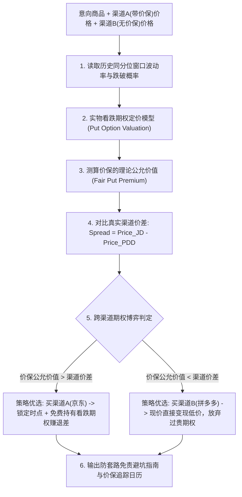

# 电商价保实物期权定价与跨渠道博弈技能规范 (Price Protection & Channel Arbitrage)

在真实电商消费中，同一款高单价耐用品在不同平台的价格与权益结构差异巨大：
- **渠道 A（京东自营）**：售价往往略高（例如 ¥8,199），但附赠 **30 天价保**，降价一键自动退差，售后体系成熟；
- **渠道 B（拼多多百亿补贴）**：现货直接破发低价（例如 ¥7,899），无 30 天无理由退差，售后退换货维权摩擦成本较高；
- **渠道 C（天猫官方旗舰店）**：官方品牌背书，赠品丰富，多件凑单满减但退差规则复杂（常排除专享券）。

消费者核心困惑在于：**多花 300 元买京东的 30 天价保，到底值不值？本质上是多花 300 元购买一份看跌期权（Put Option）是否划算。**

本技能通过**价保实物期权定价模型**与**跨渠道博弈矩阵**，将模糊的“服务感觉”转化为精确的“期权定价算账”。

---

## 核心执行流程

---

## 第一部分：电商价保实物期权定价模型 (Put Option Model)

电商 30 天价保机制在金融学上等价于消费者持有了一份**美式看跌期权（American Put Option）**：
- **标的资产现价 $S_0$**：购买当日的成交价格；
- **行权价 $K = S_0$**：平价期权（At-the-Money, ATM），任何跌破现价的部分全额退差；
- **到期期限 $T = 30 / 365$**：30 个自然日；
- **期权收益（Payoff）**：$\max(S_0 - \min_{t \in [0,T]} S_t, 0)$。

### 预期退差无条件数学期望：
$$\mathbb{E}[\text{退差金额}] = \mathbb{P}(\text{30天内降价}) \times \mathbb{E}[\text{降价幅度} \mid \text{发生降价}] \times S_0$$

### 理论公允期权溢价（Fair Premium, $V_{\text{put}}$）：
- 结合 Black-Scholes 离散回望期权（Lookback Option）特征与实证同分位历史路径；
- *实证案例*：若历史数据显示该显卡在当前分位段 30 天内有 $45\%$ 概率出现大促降价，降价均值为 $6\%$，当前现价 8,000 元：
  $$V_{\text{put}} = 0.45 \times 6\% \times 8000 = 216\text{元}$$
  **结论**：这份 30 天价保的理论纯金融价值约为 **216 元**。

---

## 第二部分：跨渠道博弈套利裁决法则 (Channel Arbitrage Rule)

令渠道价差 $\Delta P = P_{\text{自营价保}} - P_{\text{低价现货}}$：

| 博弈对比 | 量化判定 | 推荐策略与行动指南 |
| :--- | :--- | :--- |
| **$V_{\text{put}} > \Delta P$** (价保价值高于溢价) | **正期望套利** | **强烈选择京东自营**。 多付的溢价低于期权公允价值，不仅获得即刻使用权，还免费持有一张高概率退差看跌期权，30天内若遇大促大概率返还现金。 |
| **$V_{\text{put}} < \Delta P$** (价保溢价过高) | **负期望溢价** | **强烈选择拼多多/天猫低价直降**。 价保服务被平台严重高估溢价，省下真金白银现金更划算。 |
| **$|V_{\text{put}} - \Delta P| \le 50$** (两平台势均力敌) | **效用偏好主导** | 根据用户的风险偏好裁决：厌恶售后纠纷选京东，极度精打细算选拼多多。 |

---

## 第三部分：电商价保避坑与套路免责条款审计

Agent 必须提醒用户防范主流电商的四大价保“文字游戏”：
1. **优惠券排他陷阱**：平台通过发放“不可全场通用限品类优惠券”实现变相降价，系统常判定“商品标价未变”拒绝退差。
2. **赠品抵扣套路**：降价时附赠赠品，客服以“含赠品订单不享受纯价保”为由拒赔。
3. **百亿补贴/秒杀除外条款**：部分平台在细则中标明“秒杀活动、限时限量抢购不计入比价基准”。
4. **价保最佳申请时机日历**：
   - 重点监控下单后第 **7 天**、第 **14 天**、第 **29 天（到期前 24 小时）**；
   - 提示用户在到期日前一晚 23:00 点击一键价保，锁定最后一次全额退差机会。

---

## 验证与自检工具

- 运行脚本：`python .agents/skills/ecom-price-protection/scripts/option_price_protection.py --price 8199 --alt_price 7899 --vol 0.25 --drop_prob 0.40 --drop_pct 5.5`
- 输出结果：自动计算 30 天价保看跌期权公允金额、渠道净价差，并给出确定性渠道博弈裁决。
