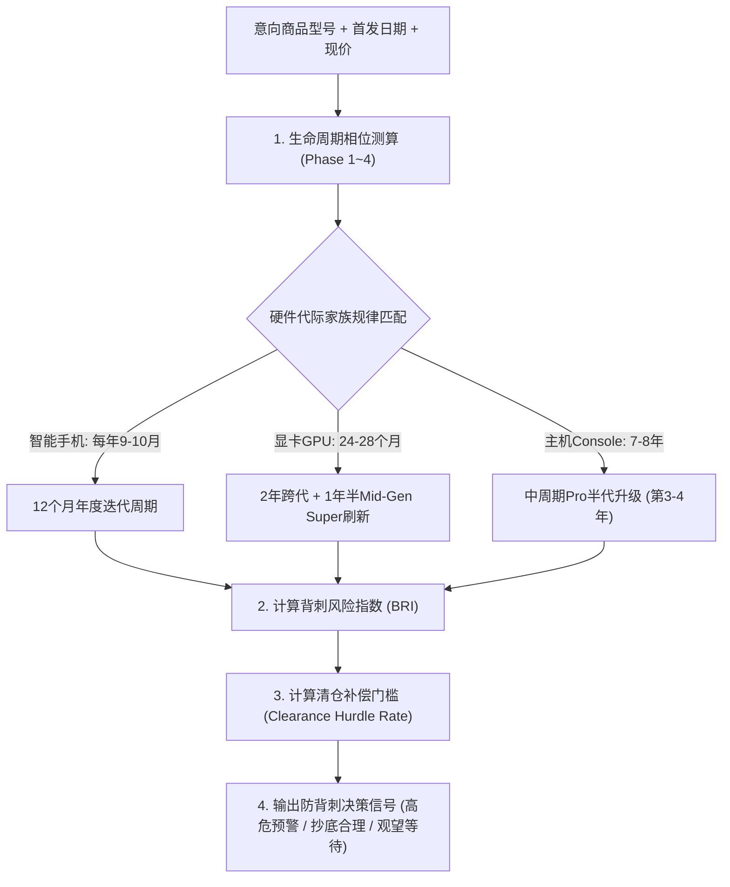

# 耐用品生命周期与换代背刺预警技能规范 (Lifecycle Obsolescence Guard)

高单价耐用消费品（尤其是 GPU 显卡、智能手机、智能车机、游戏主机）与普通消耗品最大的区别在于其具备严格的**硬件生命周期（Hardware Lifecycle）与代际淘汰效应**。
消费者最普遍的痛点是：*“刚原价或小幅折扣买入老款，不到一个月厂商发布跨代新品，老款残值断崖式暴跌 30% 以上，性能被降维打击”*，即俗称的**“换代背刺”**。

本技能通过**生命周期四相位模型**、**背刺风险指数（Backstab Risk Index, BRI）**与**清仓补偿门槛（Clearance Hurdle Rate）**，为用户筑牢防背刺安全防线。

---

## 核心执行流程

---

## 第一部分：硬件生命周期四相位模型 (Four-Phase Lifecycle)

根据耐用品生命周期长度 $T_{\text{cycle}}$，将商品划分为四个阶段：

| 相位 | 周期区间 ($t/T_{\text{cycle}}$) | 典型市场特征 | Agent 决策指导原则 |
| :--- | :--- | :--- | :--- |
| **Phase 1: 首发导入期** | $0\% \sim 25\%$ | 货源紧张、渠道溢价（黄牛加价）、原价坚挺 | 除非生产力刚需急用，否则提示**溢价降温期风险**，建议等待首波供需平衡。 |
| **Phase 2: 成熟放量期** | $25\% \sim 65\%$ | 产能稳定、开始参与电商 618/双 11 大促、价格围绕中枢小幅波动 | **黄金安全购买期**。背刺风险低，商品处于性价比与使用寿命的最佳平衡点。 |
| **Phase 3: 换代预警期** | $65\% \sim 90\%$ | 传闻与爆料密集、供应链开始备产下一代、渠道出现小幅暗降促销 | **高危背刺期**！强烈建议启动防背刺检测，计算距新品发布的倒计时天数。 |
| **Phase 4: 清仓退市期** | $> 90\%$ | 官方渠道下架或大幅直降、第三方库存清仓 | **折扣博弈期**。只有降幅突破“清仓补偿门槛”时才建议捡漏，否则坚决等新品。 |

---

## 第二部分：背刺风险指数 (Backstab Risk Index, BRI)

背刺风险指数用于定量评估当前时点买入老款被“新品降维打击”的概率与伤害度：

$$\text{BRI} = \frac{\max\left(0, 1 - \frac{\text{距下代预期发布天数}}{180}\right)}{1 + \text{当前相较首发跌幅}}$$

### 指数分级标准：
- **BRI $\ge 0.65$【极高危·红色预警】**：
  - 预期 60 天内将发布新一代，而当前老款跌幅不足 20%；
  - 核心判定：**绝不建议现在买老款，强烈等待下一代首发或老款正式退市甩卖**。
- **$0.35 \le \text{BRI} < 0.65$【中危·黄色谨慎】**：
  - 预期 90~150 天内迭代，老款处于中度折扣；
  - 核心判定：若有硬性截止期（如 30 天内实验/办公必用）可买，否则推荐观望。
- **BRI $< 0.35$【低危·绿色安全】**：
  - 新代际发布遥远或当前老款已出现断崖超跌（跌幅 $> 35\%$）；
  - 核心判定：残值已被市场充分消化，买入无后顾之忧。

---

## 第三部分：清仓补偿门槛模型 (Clearance Hurdle Rate)

当用户明知下一代即将发布，但由于老款打折而心动时，Agent 必须测算**清仓补偿门槛折扣率** $H$：

$$H = \Delta_{\text{性能代差}} + \text{未来2年残值加速折旧贴现} - \text{新品初期溢价缓冲}$$

### 实证门槛参数表：
- **智能手机（每年迭代）**：
  - 老款门槛折扣率 $H \approx 25\% \sim 30\%$。
  - *解读*：iPhone 15 Pro 在 iPhone 16 发布前夕，若价格未较首发 8,999 降至 6,400 元以下（即折扣 $< 28\%$），买老款从全生命周期残值看显著亏损。
- **显卡 GPU（2年一代，性能跨代提升 $30\%\sim 50\%$）**：
  - 老款门槛折扣率 $H \approx 35\% \sim 40\%$。
  - *解读*：RTX 4080 在 50 系列发布前夕，售价必须跌破 6,000 元才具备对抗 5070/5080 的性价比，若仍卖 7,500 元则属于“高位接盘”。

---

## 验证与自检工具

- 运行脚本：`python .agents/skills/lifecycle-obsolescence-guard/scripts/check_backstab_risk.py --category gpu --launch_date "2022-11-16" --current_price 7699 --launch_price 9499`
- 输出结果：自动计算当前商品所处相位、背刺风险指数 BRI，以及清仓门槛建议。
