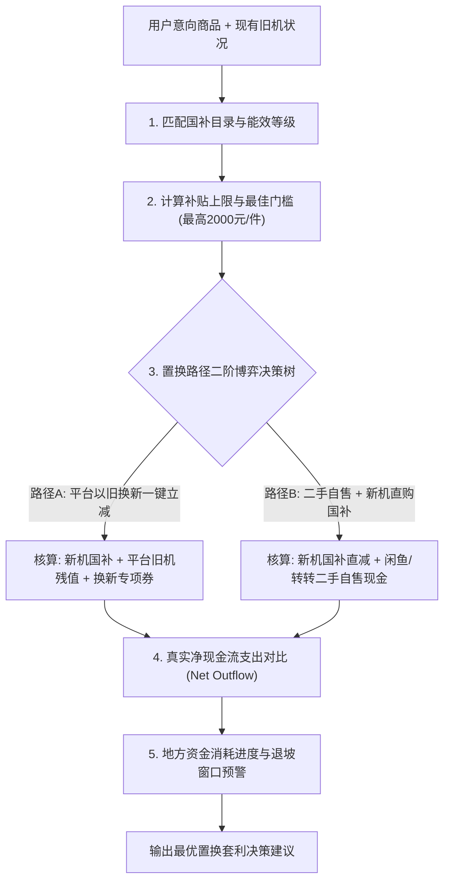

# 中国“两新”以旧换新与国补最优化决策技能规范 (Trade-In & Subsidy Arbitrage)

2024-2026年，国务院统筹安排超长期特别国债资金约 3,000 亿元，在全国范围全面实施**“两新”行动方案（大规模设备更新和消费品以旧换新）**。
这是中国耐用品消费市场近十年来力度最大的中央级财政让利，直接改变了数码家电的价格中枢与消费者购买时机。

本技能通过**补贴阶梯反解**、**渠道现金流博弈决策树**与**政策退坡预警机制**，帮助消费者在政策红利期实现合规收益最大化。

---

## 核心执行流程

---

## 第一部分：补贴阶梯反解与门槛边界

Agent 必须严格执行最新中央与地方财政补贴核算规则：

### 1. 核心品类能效与补贴比例
- **家电 8 大类（冰箱/洗衣机/电视/空调/电脑/热水器/灶具/烟机）**：
  - **1 级能效/水效**：财政补贴售价的 **20%**，单件最高补贴 **2,000 元**（购买价格达 10,000 元时补贴封顶）；
  - **2 级能效/水效**：财政补贴售价的 **15%**，单件最高补贴 **1,500 元**（购买价格达 10,000 元时补贴封顶）。
- **智能数码类（手机/平板/穿戴设备/智能数码）**：
  - 地方统筹目录：普遍享受 **10% ~ 15%** 政企双重立减，单件封顶补贴 500 ~ 1,500 元。

### 2. 边际补贴利用率（Subsidy Utilization Rate, SUR）
对于单价超过 10,000 元的高端耐用品，补贴比例随总价上升而发生稀释：
$$\text{SUR} = \frac{\min(P \times 20\%, 2000)}{P}$$
- 当商品售价为 10,000 元时，$\text{SUR} = 20.0\%$（达到最优效率点）；
- 当商品售价为 15,000 元时，由于补贴上限为 2000 元，实际补贴率降至 $13.3\%$；
- **Agent 指导原则**：对于 12,000 元以上商品，指导用户关注是否有“分拆部件发票”或“单品满减后切入最佳补贴区间”的可能。

---

## 第二部分：以旧换新二阶博弈决策树 (Trade-In Decision Tree)

面对旧设备，用户通常在“电商直接以旧换新”与“新机直购国补 + 旧机二手自售”之间犹豫，Agent 需计算两个方案的**真实现金流净支出（Net Cash Outflow, NCO）**：

### 路径 A：电商平台（京东/天猫/线下）一键以旧换新
$$\text{NCO}_A = P_{\text{新机}} - \text{Subsidy}_{\text{国补}} - V_{\text{平台旧机估值}} - B_{\text{平台专项置换补贴}}$$
- *特点*：平台旧机估值通常比二手市场低 15%~30%，但平台会提供额外“以旧换新专项券补贴”（$B$ 通常为 100~500 元），且流程省心无纠纷。

### 路径 B：分离交易（新机享国补 + 二手平台 C2C 自售）
$$\text{NCO}_B = P_{\text{新机}} - \text{Subsidy}_{\text{国补}} - V_{\text{二手自售市价}} + C_{\text{交易摩擦/时间成本}}$$
- *特点*：二手平台（闲鱼/转转）旧机变现价格更高，但存在交易沟通摩擦与退货扯皮风险。

### 裁决准则：
- 若 $V_{\text{二手自售市价}} - (V_{\text{平台估值}} + B_{\text{换新补贴}}) > 300\text{元}$：推荐【分离交易·二手自售】，多赚差价；
- 反之：强烈推荐【电商一键以旧换新】，省时且锁定官方换新补贴。

---

## 第三部分：政策资金额度监控与退坡窗口预警

Agent 必须提示宏观政策的时间与资金约束：
1. **资金池核销进度（Quota Exhaustion Risk）**：
   各省市以旧换新专项国债资金具有额度上限（如广东、浙江、江苏等首批额度消耗极快）。
2. **三阶段预警信号**：
   - **充裕期（核销 < 50%）**：建议比价并等待平台大促叠加使用；
   - **加速期（核销 50% ~ 85%）**：提示“各省每日名额需拼手速，建议在政策有效窗口期尽早确权”；
   - **收官退坡期（核销 > 85% 或 接近年底 12 月 31 日结算期）**：高危预警，“补贴随时可能提前用罄或缩水，建议立即下单锁定补贴”。

---

## 验证与核算工具

- 运行脚本：`python .agents/skills/tradein-subsidy-arbitrage/scripts/calculate_subsidy_arbitrage.py --price 8999 --efficiency 1 --old_market 2200 --old_platform 1800 --tradein_bonus 300`
- 输出结果：精确计算两种路径的净支出差额与最优补贴建议。
